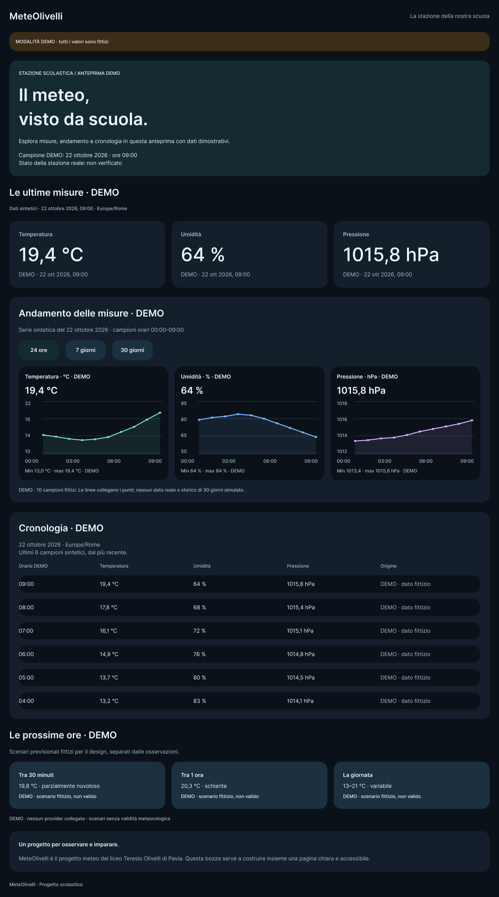
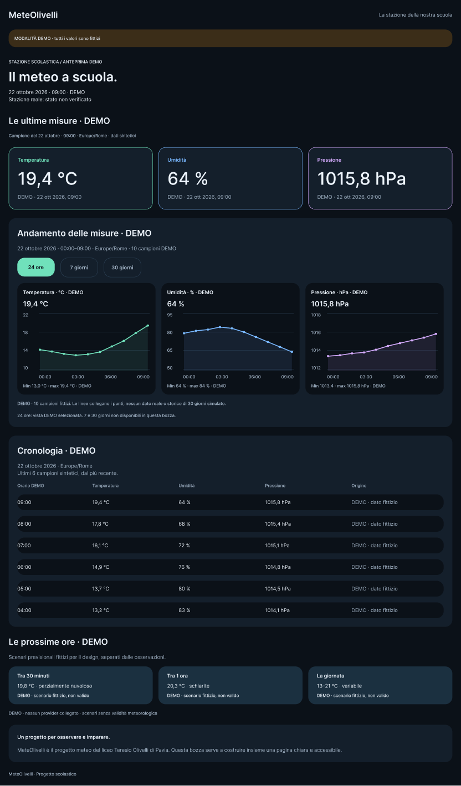
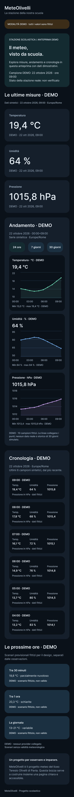
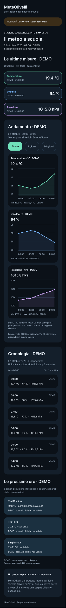
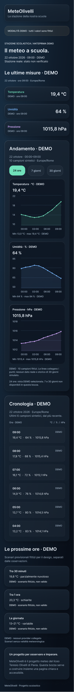

# Revisione UI con Product Design — 22 ottobre 2026

Superficie: mockup Figma MeteOlivelli dark, desktop 1280 px e mobile 390 px.
Obiettivo: trovare rapidamente le ultime misure, capirne l'andamento e consultare la cronologia, distinguendo sempre i dati sintetici dalle osservazioni reali.

[Apri la revisione v3 in Figma](https://www.figma.com/design/dMJqTphynvTgGm6yqUsVrP/MeteOlivelli?node-id=7-2).

La revisione segue le indicazioni Product Design su gerarchia, chiarezza, coerenza, fiducia e leggibilità. Gli screenshot sono stati acquisiti e ispezionati in questa sessione; non sono prove del funzionamento di un'app.

## 1. Leggere le ultime misure — migliorato

Prima: l'introduzione occupava 297 px su desktop e 281 px su mobile; le tre schede mobile occupavano complessivamente 545 px. Il titolo decorativo e le descrizioni spostavano i valori verso il basso.

Dopo: titolo su una riga, introduzione ridotta e schede mobile compatte con etichetta, valore, unità e indicazione DEMO. Menta, azzurro e lilla collegano le tre misure ai rispettivi grafici; testo e unità permettono di distinguerle anche senza colore.

## 2. Capire l'andamento — migliorato, interazioni da implementare

Prima: selezione 24 ore poco distinta dagli altri periodi; asse orizzontale esteso anche sotto le etichette dell'asse verticale.

Dopo: periodo selezionato con fondo menta e testo scuro, assi allineati alla zona del tracciato, grafici più alti e indicazione esplicita dei dieci campioni sintetici. La bozza dichiara che 7 e 30 giorni non sono disponibili: nessun archivio fittizio aggiunto per riempirli.

## 3. Consultare la cronologia — migliorato

Prima: la cronologia mobile occupava 990 px, ripetendo per ogni riga intestazioni delle tre misure e spiegazione delle unità.

Dopo: intestazione condivisa, orario e marcatura DEMO per ciascuna riga, valori con unità esplicite. Conservati tutti e sei i campioni e il loro ordinamento. L'intera composizione mobile passa da 4179 a 3553 px, circa il 15% in meno; è una misura del mockup, non una prova di maggiore usabilità.

## Evidenze visive

### Desktop — prima e dopo

### Mobile — prima e dopo

## Limiti e verifiche successive

- Prototipo statico Figma: filtri, navigazione e aggiornamento dati non sono implementati.
- Nessuna attestazione WCAG: focus, tastiera, semantica, lettori di schermo, zoom e reflow vanno verificati sul sito realizzato.
- Restano da rivedere con il compagno gli stati di caricamento, errore, assenza dati e dati in ritardo, oltre all'effettivo comportamento degli intervalli.
- Nessun dato reale o provider previsionale collegato; osservazioni e scenari previsionali restano sintetici e distinti.
- Nessun codice applicativo modificato: build/lint/test non rieseguiti per questa revisione di design e documentazione.

## Revisione successiva — frosted v4

Su richiesta dell'utente, il mockup adotta vetro satinato scuro con trasparenza contenuta, sfocatura dello sfondo di 20 px, bordi sfumati e ombre discrete. I grafici mantengono superfici più scure per la leggibilità. Nessuna distorsione, rifrazione o animazione liquid. Stili riutilizzabili creati per superfici ed effetti. Verificate visivamente entrambe le viste; tutti i dati rimangono DEMO. Il layout e i contenuti della v3 sono mantenuti salvo la finitura delle superfici e il padding dell'intestazione.

## Revisione successiva — Obsidian v5

Su richiesta dell'utente, sfondo uniforme `#05080E` (quasi nero con lieve tonalità blu), senza gradiente. Pannelli satinati più neutri, riflessi e ombre ridotti; superfici interne dei grafici più schermate. Verificati i riempimenti SOLID di desktop, mobile e area componenti e ispezionate entrambe le composizioni. Le immagini precedenti documentano le revisioni v3/v4; la versione corrente è nel file Figma. Dati DEMO invariati, nessun codice applicativo modificato.

## Indicazioni per animazioni su scroll

Aggiunte nell'area componenti di Figma e nelle descrizioni dei componenti: ingresso al primo scroll con opacità e spostamento verticale di 8 px, 220 ms ease-out; ritardo fra schede di 40 ms, massimo 120 ms. Trigger indicativo al 10% visibile. Nessun ritardo dello scroll nativo e contenuti iniziali subito leggibili. Con movimento ridotto o senza JavaScript, contenuti immediatamente visibili. Sono specifiche per la futura implementazione UI-01, non effetti già attivi.
